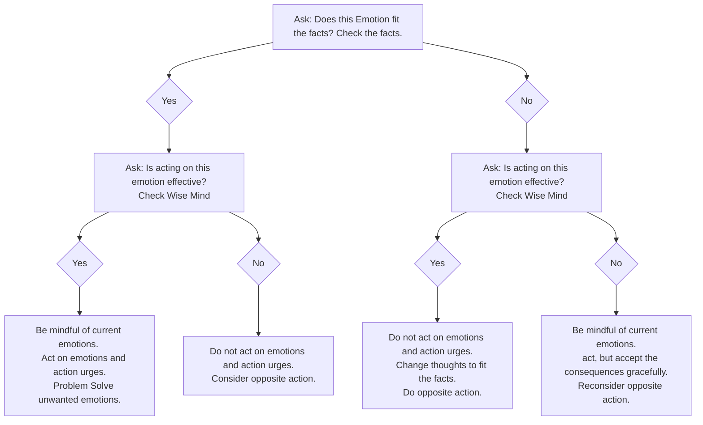

---
tags:
  - dbt
  - skill
created: 2026-8-7
status: in-progress
dbt:
  - emotion regulation
---
Loosely based on pages 220-229

## How to? 
1. Identify and name the emotion. (check p198-207)
2. Check the facts to see if your emotion fits the facts.
3. Identify and describe your action urges.
4. Ask wise mind.
If your emotion does not fit the facts or is acting on those emotions is not effective.
5. Identify opposite actions to your action urges (that are reasonable and possible) for us.
6. Act opposite **all the way**.
7. Repeat acting opposite to your action urges until we see an emotional change.

Every emotion has an action urge.
Change the emotion by acting opposite to its action urge
Consider these examples:

| Emotion | Action Urge      | Opposite Action                              |
| ------- | ---------------- | -------------------------------------------- |
| Fear    | Run away/avoid   | Approach/don't avoid                         |
| Anger   | Attack           | Gently avoid/be a little nice                |
| Sadness | Withdraw/isolate | Get active                                   |
| Shame   | Hide/Avoid       | Tell the secret to people who will accept it |
## Figuring out Opposite Actions
### Fear
Fear [[Check the Facts|fits the facts]] of a situation whenever there is a threat to
- Your life or that of someone you care about.
- Your health or that of someone you care about.
- Your well-being or that of someone you care about.

### Anger

### Disgust
### Envy
### Jealousy
### Love
### Sadness
### Shame
### Guilt
Guilt fits the facts of a situation whenever
- Your behavior violates your own values or moral code.

